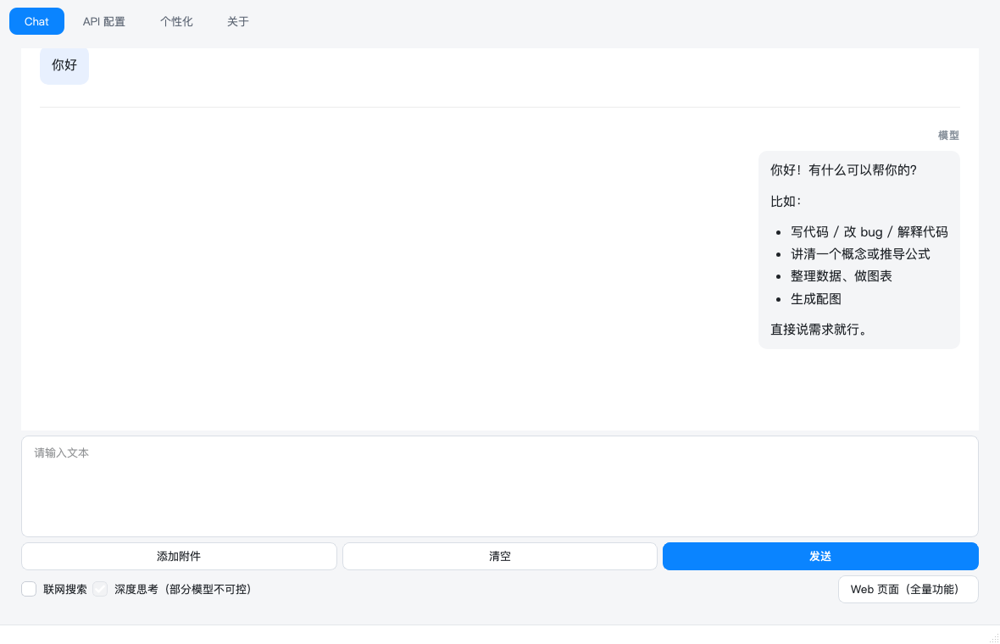
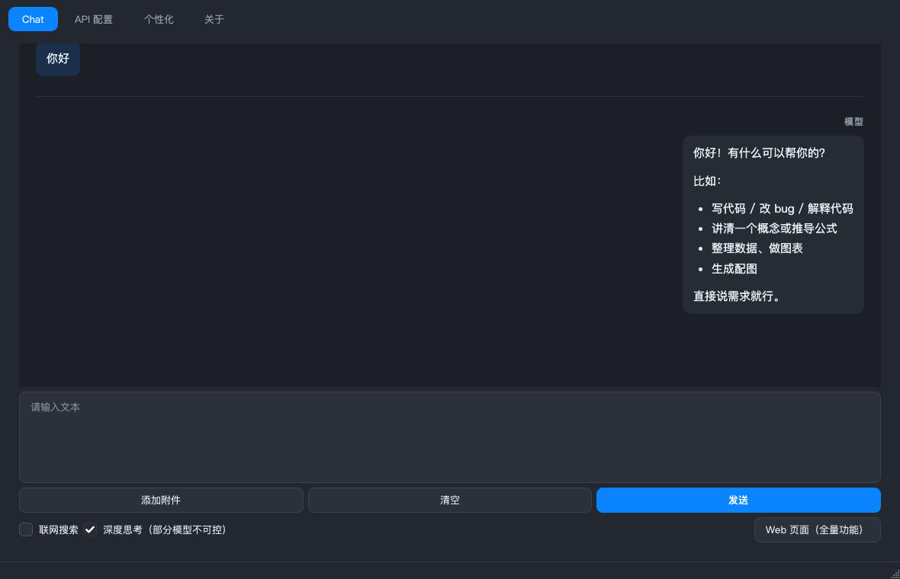

# Graphic Dev · AI Chat 桌面客户端

用 PySide6（Qt 6.12）写的本地 AI 聊天客户端：一个桌面窗口，外加一个可以在浏览器里
打开的完整网页界面。文本对话、附件分析、公式、图表、配图、联网搜索、导出都在同一个
客户端里完成，API 密钥只存在本机。

| 浅色主题 | 深色主题 |
|---|---|
|  |  |

---

## 能做什么

**对话与内容**
- 多会话管理：新建 / 切换 / 重命名 / 搜索 / 批量删除，历史落盘在系统数据目录
- 流式输出，可随时停止；深度思考模型的思考过程折叠成可展开的区块
- Markdown 渲染 + 代码高亮 + 代码块一键复制 + KaTeX 公式排版
- 回复里的图表按数据画出（`charts.py`），来源链接整理成引用区
- 附件：图片走视觉模型，文本类文件读进上下文；点附件 chip 会用系统默认应用打开副本
- 文生图：可单独配置图片接口与模型（如 `gpt-image-1` / `wanx2.1-t2i-turbo` / `flux.1-schnell`）
- 联网搜索：Bocha / Tavily / Brave 三家，结果带权威度与时间相关性重排，并有本地缓存
- 导出：Markdown / 纯文本 / Word / PDF / Excel，也可整段会话批量导出

**客户端本身**
- API 配置页：地址 + 密钥 + 模型列表（可从接口拉取，也可手动增删）+ 系统提示词
- 个性化页：界面主题（跟随系统 / 浅色 / 深色）、内置能力说明开关、删除确认弹窗
- 主题跟随系统明暗实时切换，聊天页（WebEngine）与原生界面同步变色，不用重启
- 密钥交给系统钥匙串（macOS Keychain / Windows 凭据管理器 / Secret Service），
  不可用时才回退到本地文件；仓库里不会出现任何明文密钥
- 网页端入口：本机 `127.0.0.1` + 每次启动随机 token，浏览器里是同一套后端和模型，
  设置仍回到客户端修改；网页端点附件也是让客户端替它调用系统应用（浏览器碰不到 `file://`）

---

## 快速开始

### 方式一：直接用打包好的产物

到仓库的 Actions / Releases 页面下载对应平台的包，解压即可运行（约 300–500 MB，
QtWebEngine 占大头）：

| 平台 | 包 | 备注 |
|---|---|---|
| Windows x86_64 | `AI_chat-Windows-x86_64.zip` | 解压后运行 `AI_chat\AI_chat.exe` |
| Linux x86_64 | `AI_chat-Linux-x86_64.tar.gz` | 需自备 WebEngine 系统库，见 [docs/BUILD.md](docs/BUILD.md) |
| macOS arm64 | `AI_chat-macOS-arm64.zip` | `ditto` 保留 `.app` 结构；未签名，首次打开需右键「打开」 |

### 方式二：从源码跑

```bash
git clone https://github.com/EXE0000/Graphic_Dev.git
cd Graphic_Dev

python3 -m venv .venv                # 需要 Python 3.10+
.venv/bin/pip install -r requirements.txt
.venv/bin/python AI_chat/app.py
```

首次启动进「API 配置」填地址和密钥，选好模型就能开始对话；不配图片接口和搜索 KEY
只是少了配图与联网搜索，其余功能照常。

---

## 项目结构

```
AI_chat/
  app.py              主窗口、聊天页、会话与配置（入口）
  theme.py            明暗主题引擎：QSS + 调色板 + 网页端 data-theme
  web_server.py       本地 HTTP/SSE 服务，浏览器界面的后端
  attachments.py      附件读取、副本落盘、图片 data URL
  web_search.py       联网搜索（Bocha / Tavily / Brave）与结果重排
  image_gen.py        文生图接口
  charts.py           数据转图表
  exporters.py        md / txt / docx / pdf / xlsx 导出
  formulas.py         公式渲染
  fonts.py            随包字体注册
  secrets_store.py    系统钥匙串 + 文件回退
  app_paths.py        资源目录与用户数据目录
  UI/                 Qt Designer 的 .ui 与 pyside6-uic 生成的 .py
  web/                前端：starty.html（网页端外壳）、chat.html（客户端聊天页）、
                      css/、js/、vendor/（KaTeX、marked、highlight.js）
  resources/          theme.qss / theme_dark.qss / SVG 图标 / 可选字体
docs/                 打包、跨平台、CI 指引
material/             网页端设计原型（STARTY.html 及其配图）
AI_chat.spec          PyInstaller 打包配置
.github/workflows/    三平台自动打包
```

---

## 开发约定

改代码前请先看这几条，都是踩过坑定下来的：

1. **`AI_chat/web/starty.html` 不许改**：它必须和 `material/STARTY.html` 逐字节一致。
   网页端的新功能一律通过 `web/js/app.js`（DOM 操作 + 事件绑定）和 `web/css/app.css`
   （只用新增的类名）外挂进去。CI 的「校验外壳 HTML 未被改动」会直接挡住违规改动。
2. **改 UI 要改 `.ui` 并重新生成**：用 Qt Designer 编辑 `AI_chat/UI/*.ui`，然后
   ```bash
   cd AI_chat/UI && ../../.venv/bin/pyside6-uic main_window.ui -o main_window.py
   ```
   运行时加载的是生成物，只改 `.ui` 界面不会变；CI 会比对两者是否同步。
3. **不提交密钥**：密钥只走 `secrets_store.py`。CI 有一次针对 `AI_chat/`、`docs/`
   的密钥形态扫描。
4. **换行符统一 LF**：见 `.gitattributes`。Windows 机器上如果配了 `core.autocrlf=true`，
   第 1 条的逐字节比对会凭空失败。
5. **关键功能处保留中文注释**，说明「为什么这么写」而不是「这行做什么」。

---

## 打包与持续集成

- 本地打包：`pyinstaller AI_chat.spec --noconfirm`，说明见 [docs/BUILD.md](docs/BUILD.md)、
  [docs/PACKAGING.md](docs/PACKAGING.md)
- 三平台自动打包：push 到 `main`、推 `v*` 标签或手动触发都会跑
  [`.github/workflows/build.yml`](.github/workflows/build.yml)——先跑几秒钟的前置校验
  （语法、外壳一致性、主题与图标引用、密钥扫描），过了才进三平台矩阵；产物上传后
  在 Linux/macOS 做 offscreen 启动冒烟。推 `v*` 标签时还会自动建一个 GitHub Release
  并把三个平台的包挂上去。用法与排查见 [docs/CI_BUILD.md](docs/CI_BUILD.md)

---

## 许可

本仓库暂未选择开源许可证，默认保留所有权利（All rights reserved）。
需要开放使用时请先补充 `LICENSE`。
